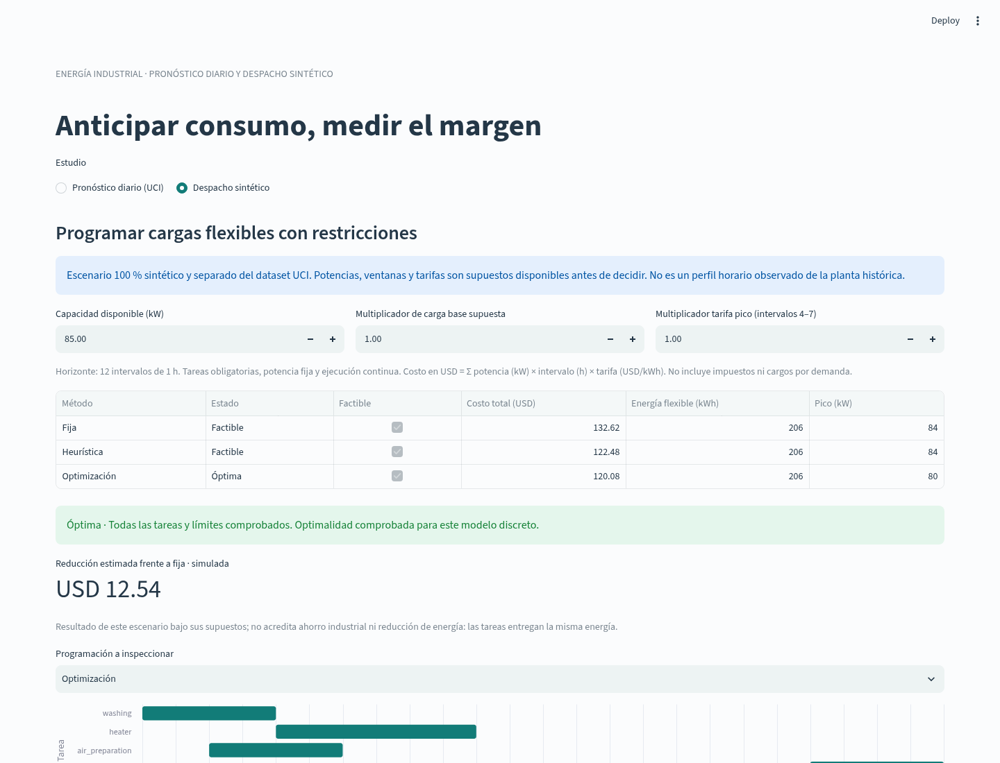

# Industrial Energy Forecasting and Constrained Scheduling

English · [Español](README.es.md)

For energy and OT/IT engineers: a chronological daily consumption study plus a separate, explicitly synthetic flexible-load scheduling exercise. The historical study uses UCI steel-industry data from 2018. It is not a live plant forecast; the scheduling scenario is not an observed hourly profile of that plant.



## Install and run

Python 3.11–3.14 and uv; this increment was tested with Python 3.12.14 and the unchanged dependency lock.

```bash
uv sync --locked --extra dev
# Historical daily forecasting, model comparison and interval evaluation:
uv run --no-sync energy-forecast run
# Independent synthetic scheduling, no forecast artifacts needed:
uv run --no-sync energy-forecast plan
uv run --no-sync energy-forecast dashboard
```

Open [dashboard](http://127.0.0.1:8504). Choose **Pronóstico diario (UCI)** or **Despacho sintético**. The latter shows task windows, scheduling, capacity, cost and sensitivity; try capacity 45 kW to see a clearly infeasible case. The forecast view retains the original held-out evaluation and daily-budget exploration. `uv run python run_pipeline.py` remains available.

## Historical forecasting

35,040 original measurements aggregate to 365 daily energy values. Four validation origins select a model, four later origins calibrate intervals, and four final origins evaluate it without reselection. Every forecast uses only history available at its origin. Weekly naive, weekday mean, SARIMA and Prophet are compared. MAE/RMSE are in kWh, WAPE is reported, and interval coverage/width are measured rather than guaranteed.

The selected weekday mean retains test MAE **602.04 kWh/day**, versus **860.48** for the weekly naive reference. Another model can perform better on test; it is not selected retrospectively. The nominal 90% interval covered all 28 test points with a wide calibration radius of 2,877.95 kWh; this small dependent sample gives no future or simultaneous-week coverage guarantee. [Generated results](reports/RESULTS.md), [metrics and environment](reports/metrics.json), [methodology](docs/METHODOLOGY.md).

## Synthetic scheduling

Five mandatory fixed-power loads, twelve one-hour intervals, explicit operating windows, minimum required energy and an 85 kW capacity. Inputs are assumed available before dispatch. Energy = power × interval duration; cost = energy × announced tariff. Compares a fixed reference, a cheapest-feasible-start heuristic and finite branch-and-bound optimization.

[Generated scheduling comparison](reports/planning/PLANNING.md): fixed USD 132.62, heuristic USD 122.48, optimum USD 120.08. All deliver the same 206 kWh of flexible energy. The USD 12.54 difference is a **simulated cost reduction under stated assumptions**, not industrial savings. The nominal schedule violates capacity under a hypothetical +20% base-load realization; sensitivity also reoptimizes under assumed load/tariff changes.

```bash
# Edit a copy of the generated input, preserving units:
uv run --no-sync energy-forecast plan --scenario reports/planning/scenario.json --output reports/custom-planning
# A limited search labels a feasible incumbent without claiming optimality:
uv run --no-sync energy-forecast plan --max-nodes 1 --output reports/limited-planning
```

The planner exports scenario.json, planning.json, dispatch.csv and a generated Markdown comparison. Infeasible scenarios still produce a report and exit 2; budget exhaustion without a feasible solution exits 3. Feasible/optimal are distinct. [Mathematical model, assumptions and Spanish interview explanation](docs/PLANNING.md).

The daily forecast does not supply an invented hourly base profile. Daily kWh cannot establish intra-hour kW capacity or task feasibility. A future integration would require independent profiles, task requirements and tariffs known before dispatch; that integration is not claimed here.

## Reproduce validation

```bash
uv run --no-sync pytest
uv run --no-sync ruff check src tests
uv run --no-sync ruff format --check src tests
uv run --no-sync energy-forecast run
uv run --no-sync energy-forecast plan
uv build
```

Tests include chronological isolation, independent brute-force optimization oracles, capacity/window/energy infeasibility, 15-minute energy conversion, budget-limited search and planning outside the checkout with no forecast files. Browser evidence covers nominal scheduling, CSV download, infeasibility, sensitivity, mobile display and independent planning without forecast reports. [Implementation status](docs/IMPLEMENTATION_STATUS.md) · [2–3 minute demo](docs/DEMO.md).

CI runs Python 3.11/3.13 tests, forecasting, scheduling and package checks. Existing Docker packaging remains available with `docker compose up --build`; its CI health check is distinct from visual validation. No local container execution is claimed for this increment.

Code: [MIT](LICENSE). Historical data: V E, S., Shin, C., & Cho, Y. (2021), Steel Industry Energy Consumption, UCI DOI 10.24432/C52G8C, CC BY 4.0; [provenance](data/README.md). Scheduling inputs are repository-authored synthetic assumptions under MIT. No private employer/customer data, real equipment writes, plant validation, RUL or guaranteed savings.
